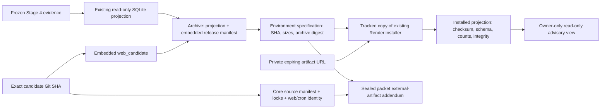

# Advisory artifact release preflight

The existing frozen Owner advisory view reads `.forecast-stage4/product.sqlite3`.
It verifies its projection SHA-256 and schema 2 at runtime. Missing files disable
that advisory view with 503; removing its build installer would regress an
existing production feature. Worker and recurring forecasting execution remain
disabled. This release does not regenerate forecasts, change the projection,
query business databases, or alter forecasting/purchasing policies.

## Binding and integrity

The archive's `web_candidate` is a release identity binding, not a dependency on
newly computed forecast data. The consumer code, schema and projection bytes did
not change between baseline 6b81c95 and failed candidate ea2c7ab. The least invasive
correction is the existing metadata-only repackage process for the new exact
candidate. Both outer specification and embedded manifest must match it. Do not
change the expected SHA alone, disable assertions, or change the installer.

`scripts/release/advisory_installer.py` is byte-for-byte the currently configured
installer (SHA-256 ff58889d4dd1b46c1b06b3eb991804121f441d54821df2bb5cfd87d7e6d38a8c).
Preflight requires its environment-encoded copy and complete build command to
match. This gives CI, local validation and Render one archive-validation
implementation. Render still executes the environment copy until separately
approved configuration changes; drift between copies is a blocking error.
The core source manifest covers tracked code and locks, not the external SQLite
archive. Archive digest, projection digest, embedded binding, schema checks and
runtime projection identity enforce distinct properties and are retained.

## Preparation and gating

1. Select an exact clean Git checkout and create the existing core source
   manifest with explicit schema, web/cron identities and baseline compatibility.
2. Independently compare frozen projection SHA-256 with existing production
   specification and retained recovery evidence. Use
   `artifact_preflight.repackage(...)` to create a new local archive. It uses
   canonical tar headers and gzip mtime=0, preserves projection bytes, never
   overwrites outputs, and does not upload or mutate any hosted resource.
3. Retain the original archive/projection and both metadata sets for recovery.
   Seal new archive/projection identities and sizes, candidate identity,
   installer/build-command digests and test evidence in a packet addendum.
   No credentials, signed URLs, private artifact/business data belong in Git or CI.
4. Obtain separately authorized artifact publication/access as needed. A local
   archive is not proof of hosted availability. Do not silently create URLs,
   upload objects, rotate credentials or alter production configuration.
5. Supply a private JSON allowlist with the seven `REQUIRED` artifact variables
   plus `RENDER_GIT_COMMIT`. Use the original configured build-command text.
   Keep the two execution flags false. URL expiry must cover at least 15 minutes;
   choose a longer margin if the build window requires it.
6. Run `python -m scripts.release.artifact_preflight --manifest MANIFEST
   --environment PRIVATE_JSON --build-command COMMAND_FILE --output NEW_REPORT`.
   Named failures identify source/binding, installer, checksum, environment,
   disabled execution or access-expiration defects without printing values.
   Configuration-only success is **INCONCLUSIVE** and exits 2. It is not a
   deployment gate PASS.
7. On an isolated clean Linux checkout at `/opt/render/project/src` with pinned
   Python 3.10.13 and locked dependencies, add `--install` to exercise the actual
   artifact command and private origin. No production database/Square credentials
   are passed to the child. This checks availability, full archive/projection
   checksums, embedded binding, SQLite integrity/schema/counts and atomic install.
8. Also execute the entire configured `BUILD_COMMAND` in that isolated checkout,
   including `sh scripts/release/build.sh`, using real authorized artifact access.
   Match the resulting build/source and projection identities to the sealed
   packet. Never use an expected SHA as observed source identity.
9. Retain separate full-command, real artifact-access and source/schema/rollback
   gates. Even `--install` PASS does not grant deployment authority or certify
   actual production schema, provider configuration, or full command execution.
   Obtain fresh production prerequisites under the separate deployment authority.

Current production's signed URL expired October 24 at 22:44:53 UTC. It must not be
used for a retry. Publishing new artifact metadata/access is explicitly outside
this preparation assignment. No URL or credential is included in the packet.

## CI evidence and limits

Artifact tests are mandatory in the fast suite, including documentation-only
PRs. Expanded selection still covers shared/unknown dependencies. Regression
cases explicitly use ea2c7ab and baseline 6b81c95, detect embedded old bindings,
expired access, missing/corrupt artifacts, checksum/lock/installer drift and
unsafe execution flags. Tests use synthetic SQLite rows, never hosted data.

The fast CI job also runs the **complete actual Render build shell command** from
a new clean worktree at `/opt/render/project/src`, with Python 3.10.13, locked
installed dependencies and both forecast execution flags false. Only its fixed
synthetic HTTPS artifact request is replaced with fixture bytes; all real Python
socket connections are prohibited and pip index access is disabled. The result
is labelled **synthetic configured-command rehearsal**, not full Render or live
R2 qualification. This catches shell/installer composition failures reproducibly
without production credentials. Real origin access and the prepared private
projection still need separate, credential-isolated validation before deployment.

No branch protection, provider setting, deployment trigger, live installer,
artifact object, cadence, key, production data or business feature is changed by
these source changes. A new source commit requires its own CI receipt, sealed
packet and deployment approval. The ea2c7ab approval does not transfer.
