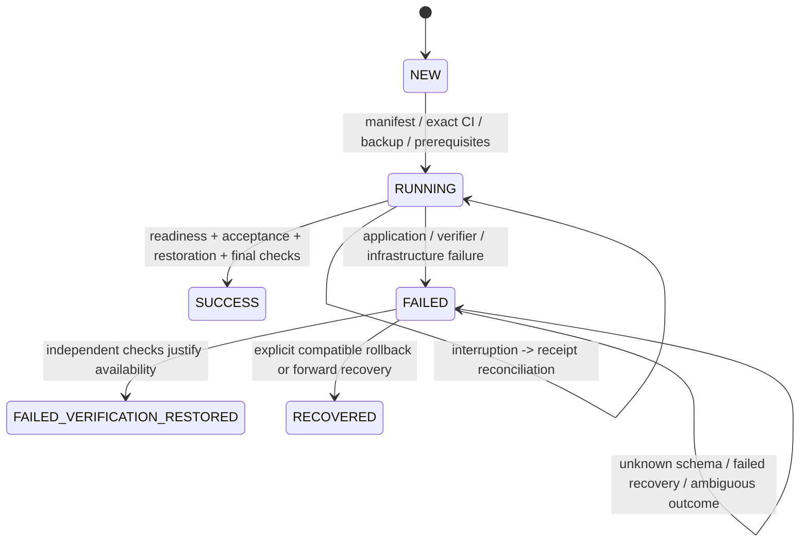

# Release verification and recovery — Phase 3

Status: implemented for local/disposable qualification only. This does not
activate deployments, maintenance, migrations or cron controls. Production
activation requires a separate Owner instruction naming an exact release.

## Architecture

```mermaid
flowchart LR
  S[Clean exact commit] --> B[Existing build and source attestation]
  B --> M[Sealed release manifest and source archive]
  M --> C[Exact final-commit expanded GitHub CI]
  C --> Q[Read-only CI qualification]
  Q --> J[Durable coordinator journal and environment lock]
  J --> P[Local simulated provider only]
  P --> R[Independent readiness]
  R --> F[Functional acceptance]
  F --> A[Independently justified availability restoration]
  A --> E[Release report and audit chain]
```



The implementation is `scripts/release/phase3/`: manifest preparation,
GitHub qualification, verification contracts, a private durable journal, a small
coordinator and a disk-backed provider double. The sole reachable mutation
adapter is exactly the bundled `Simulation` class. Subclasses, arbitrary
providers and live service adapters are rejected. There is no deployment CLI,
HTTP mutation client, Render credential loader, new deployment workflow,
production environment or production secret.

The existing owner-only `/management/deployment/runtime` remains available.
`/management/deployment/readiness` adds independent GET-only readiness. It checks
process responsiveness, `SELECT 1`, the actual Alembic revision against the app's
supported revisions, and startup/current source attestation. Its database
transaction is read-only. It returns 503 for failed prerequisites and never
exposes SQL errors/connection details. Its body must be checked alongside the
HTTP status. Cron evidence comes separately; web cannot attest another service.

Database, schema and intact source are required process dependencies. Square and
R2 are business integrations rather than process readiness dependencies. Their
availability must be tested in the release-specific functional plan when that
release changes them; no new provider credentials or real business calls are
introduced here.

## Release manifest v1

The manifest is canonical JSON with a SHA256 `manifest_id` over every field
except that ID. Files are created exclusively, never overwritten.

| Field | Contract |
|---|---|
| `format` | `erupted-release-v1` |
| `revision` | Full 40-character Git commit; never a branch name |
| `source_tree_sha256` | Existing build attestation over tracked runtime files |
| `artifact` | Deterministic `git archive --format=tar` source archive, exact revision and byte SHA256 |
| `lockfiles` | SHA256 of both hash-locked production/test requirements |
| `schema` | Starting revision, single expected head, exact ordered required migrations and candidate-supported schemas |
| `roles` | Explicit web and cron revision/source digest; v1 requires the same candidate |
| `baseline` | Full recovery commit, source/archive digests and explicitly reviewed schema support |
| `compatibility_review` | Retained review/evidence reference; compatibility is never inferred merely from migration names |
| `backup_requirement` | `verified-recovery-point` for code-only releases; `isolated-restore` for migration releases |
| `maintenance_required` | Explicit boolean; migrations require maintenance and cron fence |
| `verification` | Suite `erupted-verification-v1` plus verifier/endpoint source digest |
| `built_at` | Timezone-aware build-attestation/package timestamp |

This is an immutable **source** artifact, not a frozen OS/container promotion.
Python, application dependencies and PostgreSQL tests remain pinned by Phase 2.
An eventual Render adapter must preserve this identity through the actual native
build or promote an independently attested binary. Untracked/environment-encoded
source overlays and mutable installer downloads cannot be accepted under this
manifest without explicit content-addressed inclusion and runtime attestation.

Example offline preparation after the existing build passes, using actual full
SHA values and an independently reviewed baseline/schema:

```sh
python -m scripts.release.phase3 prepare \
  --root /absolute/clean/checkout --revision FULL_CANDIDATE_SHA \
  --from-schema REVIEWED_CURRENT_SCHEMA \
  --baseline-revision FULL_BASELINE_SHA --baseline-supports REVIEWED_COMPATIBLE_SCHEMA \
  --compatibility-review REVIEW_RECORD --output /private/new-candidate-directory
python -m scripts.release.phase3 verify \
  --root /absolute/clean/checkout \
  --manifest /private/new-candidate-directory/manifest.json \
  --artifact /private/new-candidate-directory/source.tar
python -m scripts.release.phase3.qualification \
  --repo flyinghampsterofdoom/erupted-blind-inventory-portal --run EXACT_SUCCESSFUL_RUN_ID \
  --manifest /private/new-candidate-directory/manifest.json \
  --output /private/new-candidate-directory/qualification.json
```

Qualification uses GET-only GitHub APIs and downloads synthetic CI build evidence.
It requires the GitHub Actions app, a completed successful push/manual run at the
exact final SHA, all eight expanded groups and both planning/final jobs, and the
actual CI build's revision/source digest. A green PR merge ref does not qualify
a different branch/main SHA. Normal future releases can use the automatic
main-push run. Rebuilding/preparing a candidate after a source/archive change
requires a new manifest and qualification.

## Independent verification and classifications

Readiness checks exact web **and** cron identity, process/database/schema/source
prerequisites and compatible actual schema. The new web readiness route does not
pretend to supply actual cron execution evidence. Existing
`verify_runtime.verify_cron_logs` continues to require runtime identity and a
matched successful natural run. Never trigger a scheduling run as a smoke test.
The simulated provider models this evidence boundary; production wiring and a
fresh natural-run qualification remain activation prerequisites.

The fixed functional plan uses ordinary Owner, Lead and Store sessions plus an
anonymous client. It checks session principal identity, anonymous scheduling
redirect, scheduling board data, Lead schedule access, Owner purchasing and
inventory-session read pages, and denied Lead/Store purchasing access. Requests
are GET-only with redirects disabled. Exact expected role principal IDs must be
provided. Expired/unavailable ordinary sessions are verification-context failures,
not evidence of a broken application. No SQL sessions are invented or prolonged.
Real local app tests confirm the only resulting writes are normal middleware
session renewal, with no business writes or Square requests.

| Classification | Examples | Meaning |
|---|---|---|
| `application` | Proven wrong revision, incompatible schema, unready dependency, genuine HTTP/authorization violation | Observed application gate failed |
| `verification` | Incorrect assertion, parser defect, unsupported response shape, malformed expectations, missing session context, candidate/CI evidence mismatch | Application health unknown; verification did not pass |
| `infrastructure` | Connection reset, provider timeout/outage, lost operation response, failed availability restoration | Evidence/operation unavailable; verification did not pass |

Unexpected exceptions and `AssertionError` become verifier failures. Raw exception
messages, response bodies, session cookies and credentials are excluded from
reports. Explicit gate failures retain stable reason codes and boolean/status
observations. A verifier failure cannot become application success; independently
proven availability restoration still ends `FAILED_VERIFICATION_RESTORED`, with
the original failure retained.

October 24 regression coverage recreates `dict(response.headers).get('Location')`
missing a valid lowercase `location`. The shared parser normalizes names,
accepts mixed casing, rejects conflicting duplicates and checks a local `/login`
redirect without following it. Both email-style HTTP header objects and plain
header dictionaries are tested.

## Durable state machine and recovery



Every simulated mutation is preceded by a fsynced intent. Receipt and completion
are durable. Restart reconstructs state from disk. A pending action is reconciled
with provider evidence; absent/ambiguous evidence never causes blind resubmission.
Failed actions are not silently retried. Explicit recovery uses a separate
journal namespace, preserves the original failure and never reports the original
release as successful. A lost deployment response cannot create a duplicate deploy.

A nonblocking OS flock is bound to the canonical simulated provider/environment
path, so different journal names cannot run concurrent operations against that
same environment. OS process termination releases the lock. Files are private
(0600), directories 0700, writes atomic/fsynced, and events form a hash chain.
This is a local crash-recovery/audit mechanism, not an authenticated distributed
log or a multi-host lock. Production activation must provide one durable controller
host or an independently reviewed shared lock; GitHub concurrency alone is not a
durable recovery journal.

Recovery observes the actual schema. A baseline can run only schemas explicitly
listed in its reviewed contract. Compatible rollback retains the new schema and
deploys only the known baseline application; no downgrade or business restore is
performed. An incompatible baseline is refused. Forward recovery can explicitly
redeploy the same qualified candidate against its supported actual schema. A new
fix commit needs a new manifest and CI qualification. Partial/unknown schema is
held for separately authorized database recovery. Failed rollback remains held.

Fresh independent readiness and acceptance are required before cron restoration,
after cron restoration (resume can rebuild), and after maintenance restoration.
Original deliberately suspended cron/maintenance settings are preserved. Timeouts
never reopen maintenance or resume an incompatible cron. There is no periodic
watchdog that can mutate production. The journal clearly reports an incomplete
restoration so an operator can resume/recover with evidence rather than a timer.

## Exercises and operating cost

```sh
python -m scripts.release.phase3.rehearse --output /absolute/new-rehearsal-directory
python -m pytest tests/test_release_phase3.py tests/test_release_phase3_http.py
```

Twenty-two scenario exercises cover successful release; failed deployment/migration;
incorrect assertion; header casing; provider timeout; network interruption;
web/cron mismatch; interrupted/resumed coordinator; compatible rollback;
incompatible forward recovery; maintenance and cron restoration failures;
concurrent attempts; failed rollback; unready application; unknown schema;
failed CI; missing backup evidence; lost deployment response; deployment-readiness timeout; and delayed natural cron completion. Assertions check
final state and the audit trail. Failures remain visible even after recovery.
Safety/policy tests run in every fast CI job; real app/PostgreSQL checks run in
expanded validation.

The rehearsal records preparation/verification/recovery timings, logical simulated
provider calls, final states, mutation counts and operator invocations. No paid
service, permanent staging, extra database service, background controller or new
production credential is required. The future coordinator replaces the eleven
listed orchestration stages with one invocation in the successful simulation;
production time savings remain unmeasured until a separately authorized pilot.
Recovery decisions require an explicit extra invocation when a release fails.

Maintain the finite response/role contracts, migration compatibility reviews,
fixture provider shapes, action/lock/journal code and verifier version together.
Run the fault exercises after changing any of them. Preserve failed-attempt
reports; do not hide them by rerunning until green.

## Production activation plan — separate authorization required

1. Review/merge this PR under existing CI protection; merging enables no deployer.
2. Owner separately authorizes a named pilot release and reviewed recovery plan.
3. Implement/review the missing narrowly scoped live adapter; keep auto-deploy off.
   Prove exact web `commitId`, pinned cron branch, provider receipts, resume/build
   behavior and natural-run attribution with current provider contracts. Never
   reuse native web rollback for cron or manually trigger its scheduling run.
4. Bind actual backup/isolated-restore evidence, migration prerequisites, provider
   configuration fingerprints, exact Actions run and artifact qualification to the
   manifest. Reconfirm no environment source overlay or mutable download can
   bypass attestation. Supply normal, least-privilege verification sessions.
5. Place the journal and environment lock on one durable controlled executor;
   rehearse cancellation, provider ambiguity, recovery and operator escalation.
6. Execute one explicitly authorized pilot; compare production business/config
   fingerprints, exact web/cron runtime proof and natural cron success. Publish
   final evidence before considering future automatic verification activation.

Production deployment/configuration changes, maintenance, cron suspension,
migrations, new credentials and automatic deployments remain unauthorized here.
