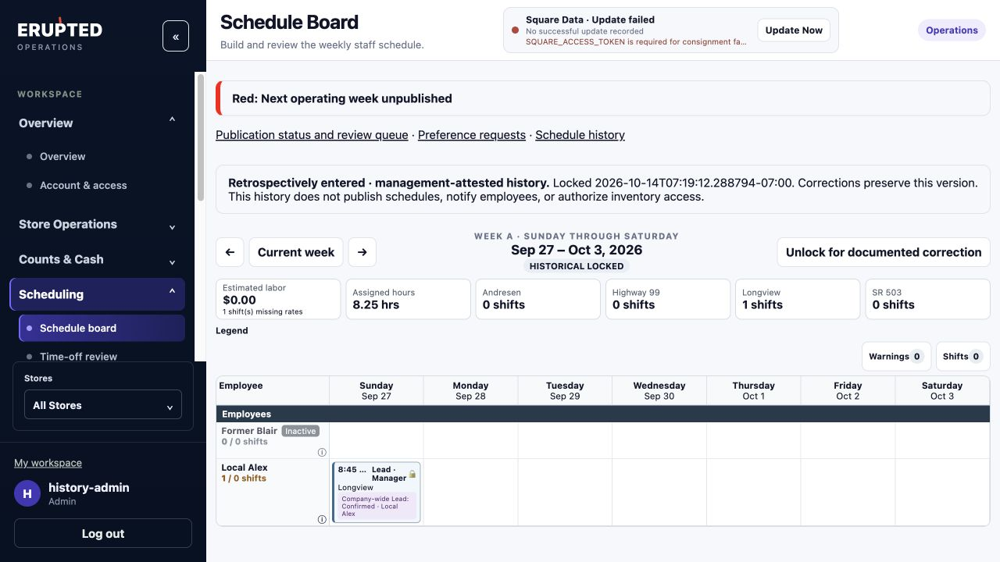
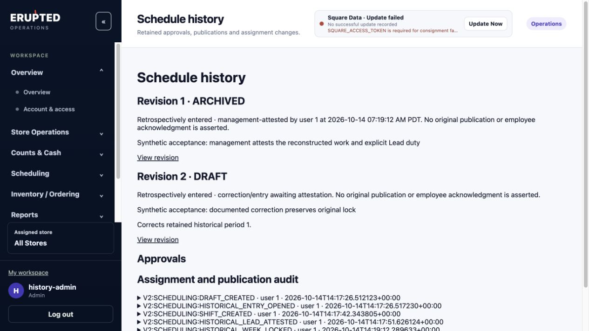

# Scheduling V2 historical week backfill

Implemented in the isolated scheduling worktree on `codex/scheduling-historical-backfill`, based on production correction `91cd0fb8c6f8bd15af93971b52746db80cf2eaeb`. Production was not inspected, migrated, configured, or deployed during this development task.

## Workflow

An active **Admin** can use the existing previous-week navigation, then **Open historical entry week**. Only wholly completed Sunday–Saturday weeks are eligible. Existing past drafts can be opened for reconstruction; an existing published historical schedule is copied to a separate retrospective revision, preserving the published record. Cleared schedule intent is not seeded as evidence of completed work. A missing week receives an empty historical entry period.

The existing weekly board and shift editor support manual employee/store/day/time entry, including former employees. Historical entries validate identities, date boundaries, interval/break consistency, and employee overlap; they do not substitute current roster eligibility, availability, trading hours, or future-planning rules for what actually happened. Missing days are unknown and receive no reconstructed credit. Current and future generation/publication keep the approved preopening validation.

**Attest Lead duty** explicitly identifies company-wide responsibility for a day, with a source or correction reason. **Clear historical Lead duty** removes an unsubstantiated designation from an editable reconstruction. Automatic operational Lead designations are not converted into historical responsibility. Existing explicit Lead-duty outcome evidence remains authoritative.

**Lock Historical Week** requires a documented management attestation and the board's current version. Every entered shift must identify an employee and pass structural validation. The period becomes archived/closed with the actual attestation timestamp and Admin identity. It receives no original publication timestamp, publisher, approval, or employee acknowledgment. Empty weeks cannot be attested as work.

**Unlock for documented correction** creates a new historical draft revision. It preserves the prior locked period and its assignments unchanged. The previous attestation remains the fairness authority while the correction is incomplete; locking the correction replaces its fairness contribution. Older versions remain readable through Schedule history. Assignment creation, changes, deletion, Lead attestations, locking and correction operations are audited. Deleted draft assignments remain discoverable in the existing audit history.

## Fairness and workload

The existing attendance resolver is reused. Existing active attendance and coverage evidence takes precedence over retrospective assertions for the same assignment lineage or overlapping work involving the employee. Confirmed absences and unresolved duration/conflicts do not become fabricated work. A coverage replacement receives credit instead of the absent original employee.

Management-attested work supplies fallback historical facts where stronger evidence does not already resolve that work. Only the latest locked historical revision per week contributes. Separate employees legitimately working the same store interval retain their separate credits; matching store/time alone is not treated as a duplicate identity.

- Longview rotation remains measured in employee/Sunday-start weeks, not individual shifts. Multiple Longview shifts in one week earn one employee-week credit.
- Saturday and Sunday fairness remain separate date counts within the existing trailing 12-week horizon. Existing special-store exclusion is preserved; Longview has its separate rotation calculation.
- Lead fairness remains company-wide and at most one responsibility credit per day. Explicit existing Lead-duty outcomes take precedence. Ordinary work attendance or employee capability alone does not establish retrospective Lead duty.
- Existing weekly hour, shift-count and work-pattern reporting resolves attested completed weeks through the same historical/attendance facts. Former employees can retain historical workload credit. Current/future planning queries exclude historical entry drafts and locked history from reservations.
- Fairness is recomputed from current evidence on read; no duplicate counters or independent historical-assignment database were added.

## Safety and concurrency

All historical mutations require a literal active Admin on the backend. Existing CSRF, feature exposure, identity, store scope, auditing and global scheduling transaction lock are reused. Expected board versions reject stale lock/shift/Lead operations. Concurrent unlocks create at most one editable correction; concurrent locking and editing cannot commit a stale attestation.

PostgreSQL triggers reject inserting, updating or deleting assignments in a locked historical period, and updating/deleting the locked period itself. Ordinary generation/regeneration, repair, template replacement, approval and publication cannot operate on historical entry periods. Historical periods are also rejected as operational copy, reusable-template, or generation sources, so the existing copy APIs cannot turn backfill into future reservations. The board displays no historical generation/publication or active swap/emergency-store actions.

Historical periods are never published. They cannot become the published working-store authority, issue inventory grants, increment employee working-context versions, or notify employees. The implementation does not write attendance, coverage commitments, actual Lead-duty outcomes, inventory counts/entries/observations, employee account links, or live published schedules.

## Validation

**Broad regression: 1,464 passed, 7 subtests passed, one opt-in external-storage smoke test skipped. Final targeted regression: 68 passed (all 50 historical acceptance cases and 18 existing operational copy/template cases).** The broad suite preceded the final source-quarantine guard; the final targeted run verified that guard and its unaffected operational copy/template paths. Python compilation, JavaScript syntax and dependency checks passed. Machine-readable evidence and tested source hashes are in `docs/development/evidence/scheduling-history-backfill-acceptance.json`. The focused PostgreSQL acceptance suite covers historical navigation, creation, assignment, locking, revision correction, former employees, Longview/weekend/Lead attribution, attendance and commitment precedence, duplicate-credit protection, double coverage, weekly workload reporting, literal Admin authorization, stale versions, concurrent writers, database immutability, schema migration, and inventory/published-schedule isolation.

Local browser verification exercised Admin sign-in, historical entry creation, manual Longview assignment using the existing shift editor, explicit Lead attestation, historical locking, immutable board controls, documented unlocking into a distinct correction revision, and sequential backward navigation. Synthetic data and local credentials were used. The synthetic app has no Square credentials; its existing missing-credentials status banner is expected and is not a production health finding.

## Migration and release implications

The feature requires **`20261013_0033` → `20261014_0034`**. Migration 0034 adds four historical provenance fields, two check constraints, the historical attestation principal foreign key, and two immutability triggers sharing one function. It does not rewrite existing business records, introduce a new period status enum value, or add an independent assignment store. Existing periods default to nonhistorical.

The local migration acceptance test downgrades an empty disposable schema to 0033, seeds representative original business rows, migrates to 0034, compares every original period column plus employee and audit rows, then verifies attested history prevents a downgrade back to 0033. The complete regression also verifies canonical migration ancestry and existing evidence-preserving downgrade restrictions.

**This is development acceptance, not production release authorization.** Before deployment:

1. Prepare and identify the exact schema-0034 web/cron candidate and compatible recovery artifact.
2. Rehearse migration against a securely handled disposable production-data copy and verify original records, existing 28 opening-hour records, corrected Store Shift #3, 36 retained draft conflicts, permissions/exposure, and inventory/attendance evidence.
3. Run Linux runtime and release-gate verification on the exact packaged artifacts.
4. Update release tooling/checklists that are explicitly frozen to schema 0033; do not use those manifests or rehearsal commands unmodified for 0034.
5. Establish a fresh verified checkpoint, writer freeze, bounded migration/deployment order, stop conditions, and forward-recovery procedure for separate authorization.

The production schema-0033 web and recovery `888a7df8b66f2ac6f50112dd506bfbe3e946cc0d` have not been represented as schema-0034 compatible. A new compatible recovery artifact is required before a release. Once any historical record exists, the 0034 downgrade refuses to discard its provenance or immutability protections; recovery must preserve schema 0034 and retained evidence. Do not restore a pre-migration checkpoint over subsequent scheduling or inventory work.

No production backfill, schedule generation/publication, feature exposure change, automation activation, or deployment is authorized by this implementation.
