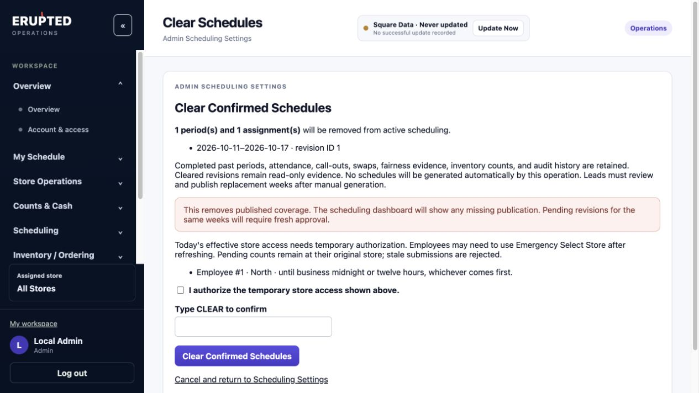
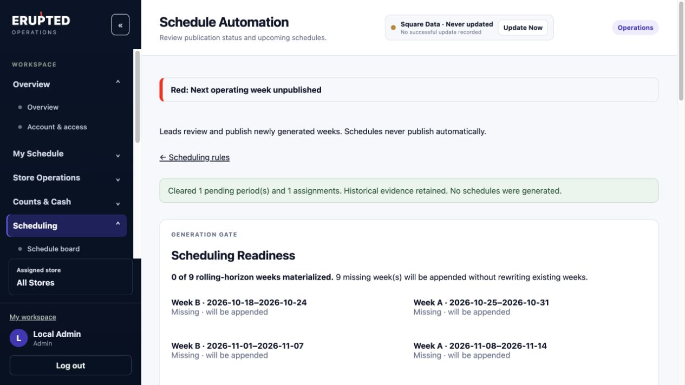

# Scheduling V2: Admin schedule clearing

Implemented in the isolated `codex/scheduling-prebeta` worktree on October 13, 2026. No production access, migration, deployment, provider mutation, feature exposure change, or automation activation was performed for this change.

## Behavior

Admin Scheduling Settings now offers **Clear Pending Schedules** and **Clear Confirmed Schedules**. Each opens a server-rendered preview of the matching current/future period and assignment counts and date ranges. A current period is one whose business-local week has not ended. The server requires an active **Admin role**, CSRF validation, the exact text `CLEAR`, and a matching preview fingerprint. Capability overrides cannot authorize Managers, Leads, or Store accounts.

Clearing removes periods and their assignments from operational scheduling by retiring their revisions. It does not physically delete referenced records. Retained revisions are archived, closed, timestamped, and shown as cleared historical evidence. Completed past periods are untouched. Assignment IDs, publication lineage, approvals, immutable generator snapshots, attendance, call-outs, coverage commitments, swaps, Lead-duty outcomes, inventory counts, and existing audit records remain intact. No foreign keys are detached and no schedule is generated by the operation.

A confirmed clear also marks the older published revisions of those weeks as cleared, preventing their cancelled future intent from later acquiring presumed fairness credit. Completed historical credit and explicit attendance evidence remain available. Pending revisions of those weeks remain pending, but their versions advance so old approvals cannot republish them without fresh review and approval. The reset audit identifies retired revisions, affected counts, prior revisions, invalidated draft approvals, and temporary inventory grants.

All scheduling HTTP mutations and relevant service entry points share the existing transaction advisory lock with generation, approval, publication, swaps, and attendance. Period/employee row locks and refreshed ORM state protect the final decision. Changed previews fail without partial clearing. Concurrent manual generation either completes before the reset and invalidates its preview, or starts after the reset as a separate transaction. Retained revision numbers allow fresh manual drafts to recreate current weeks; manual horizon generation recreates missing future weeks without publishing them.

## Blind Inventory

A confirmed clear previews today's affected effective working stores. The Admin must explicitly authorize the displayed temporary inventory access as part of confirmation. Grants use the existing emergency-store authorization infrastructure and expire at business midnight or twelve hours, whichever comes first. Existing valid emergency grants carry forward with their original expiration; they are not extended. The effective store is resolved from published assignments, attendance/coverage exceptions, and store swaps, never from an employee's original assignment or home store. Ambiguous assignments do not create new store access.

Employee context versions advance atomically with clearing. All active sessions must refresh their context; stale submissions fail server-side. Where needed, the existing hidden Emergency Select Store interface becomes available for the explicitly authorized store. Counts and browser draft buffers remain attached to their original stores. New publication or swaps continue to invalidate grants through the established context-version mechanism. Legacy unlinked store accounts retain their established scope.

## Local verification

Verification uses disposable local PostgreSQL databases, synthetic identities and inventory, the locked Python test runtime, and mock inventory providers. Browser acceptance exercised both previews, required checkbox authorization, invalid lowercase confirmation, successful `CLEAR` submission, missing-horizon display, and no automatic regeneration.

The focused cases cover literal Admin authorization (including capability overrides), inactive accounts, CSRF, current/future versus completed periods, both statuses, exact confirmation, stale previews, unchanged completed inventory observations and draft values, unchanged attendance/call-outs/commitments/audit rows, immutable snapshots, nine-week manual recreation, cleared future fairness, version-bound approvals, same-day swapped store access, emergency expiration, two logged-in sessions, inventory submissions during transition, and concurrent edits, publication, creation, and actual regeneration. Migration tests verify `0031 → 0032 → 0033`; downgrade refuses to discard a retained clear marker.

Final results:

- **33 new clearing acceptance cases passed**, including four stale ORM identity cases which verify that existing manual locks and designations remain exactly unchanged.
- The full regression run completed with **1,352 passing tests**, seven passing subtests, one optional real-R2 test skipped, and two obsolete schema-head assertions. Both assertions were updated from 0032 to 0033 and passed in a **50-test focused verification** covering the clearing cases then present, schema expectations, and template/copy behavior.
- After the final helper hardening, **52 existing Lead/double-coverage/lock/transfer regression cases passed**; all 33 clearing cases passed on the final code. Across the full run and corrected/expanded focused reruns, **1,366 distinct tests passed**, with no unresolved failures. This is combined verification, not a claim that a second full-suite run was performed.
- A separate **92-test pre-beta, release-tool, clearing, and canonical-migration run passed** during development. Migration 0033 roundtrip/refusal and nine-week recreation are covered locally; a fresh production-data rehearsal has not been performed for 0033.
- Browser checks passed for both controls. The disposable browser database was removed and its local preview server stopped. The canonical checkout remains unchanged and clean.

## Release implications

The application schema head is now `20261013_0033`, adding nullable `schedule_periods.cleared_at`. Release preparation, rehearsal, probe, and bounded-recovery tooling now target that schema. Previously sealed schema-0032 archives and their successful production-data rehearsal remain historical evidence for the earlier candidate; they do not qualify this candidate for deployment.

Before release, repeat artifact preparation and migration rehearsal through 0033, verify retained reset evidence and the new controls in the release artifacts, and build/test a schema-0033 bounded recovery artifact. A downgrade to 0032 is refused after any clearing operation because losing the marker could turn cancelled assignments into presumed historical credit. Use schema-compatible forward recovery. Production deployment and automation activation still require separate authorization.
